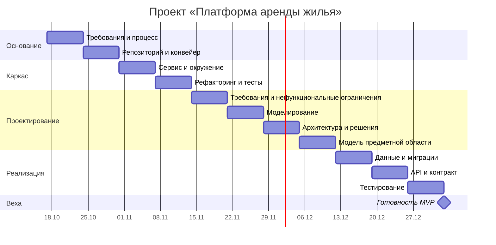

# План семестра

Диаграмма показывает порядок работ и зависимости. Это инструмент коммуникации, а не обязательство по каждой задаче. Недельные задачи планируем на встрече планирования.

## Диаграмма

## Контрольные точки

| Точка                 | Срок      | Критерий прохождения                                                      |
| --------------------- | --------- | ------------------------------------------------------------------------- |
| Требования утверждены | конец М01 | Домен согласован, MVP зафиксирован                                        |
| Конвейер зелёный      | конец М02 | Ветка защищена, проверки проходят                                         |
| Сервис поднимается    | конец М03 | Одна команда запускает рабочее окружение                                  |
| MVP работает          | конец М11 | Сквозной сценарий от объявления до подтверждения брони проходится целиком |

## Буфер

На непредвиденное заложено 20 % времени каждой вехи. Расход буфера фиксируем в [журнале изменений](CHANGELOG.md).

## Способ планирования

План построен от цели: известен срок защиты, и мы выясняем, что минимально должно работать к нему. С модуля 03 начнём сверять его с реальной скоростью.
