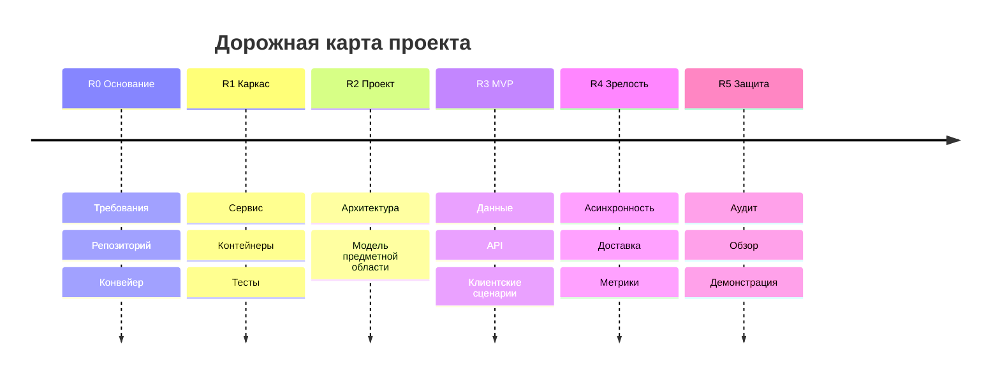

# Дорожная карта

[План семестра](gantt.md).

## Вехи

| Веха              | Модули  | Что будет готово                                                                                                    |
| ----------------- | ------- | ------------------------------------------------------------------------------------------------------------------- |
| **R0. Основание** | М01–М02 | Требования, карты, репозиторий, процесс, конвейер проверок                                                          |
| **R1. Каркас**    | М03–М04 | Работающий сервис, окружение в контейнерах, первые тесты                                                            |
| **R2. Проект**    | М05–М08 | Требования с нефункциональными ограничениями, диаграммы, архитектурные решения, модель предметной области           |
| **R3. MVP**       | М09–М11 | Данные, API, клиентские сценарии: объявления, модерация, поиск и карта, заявки, чат, отзывы. Стратегия тестирования |
| **R4. Зрелость**  | М12–М14 | Асинхронный сценарий (уведомления, истечение заявок), доставка, наблюдаемость                                       |
| **R5. Защита**    | М15–М17 | Клиентское приложение, аудит, архитектурный обзор, демонстрация                                                     |

## Схема

## После MVP

Оплата аренды с комиссией и залогом, формирование и подписание договора, продление аренды, проверка личности и другие города. Полный список в [requirements.md](requirements.md).
